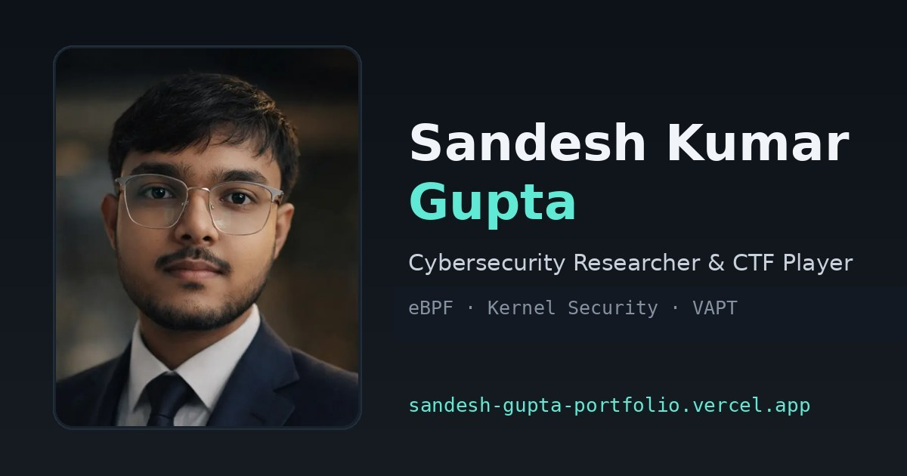
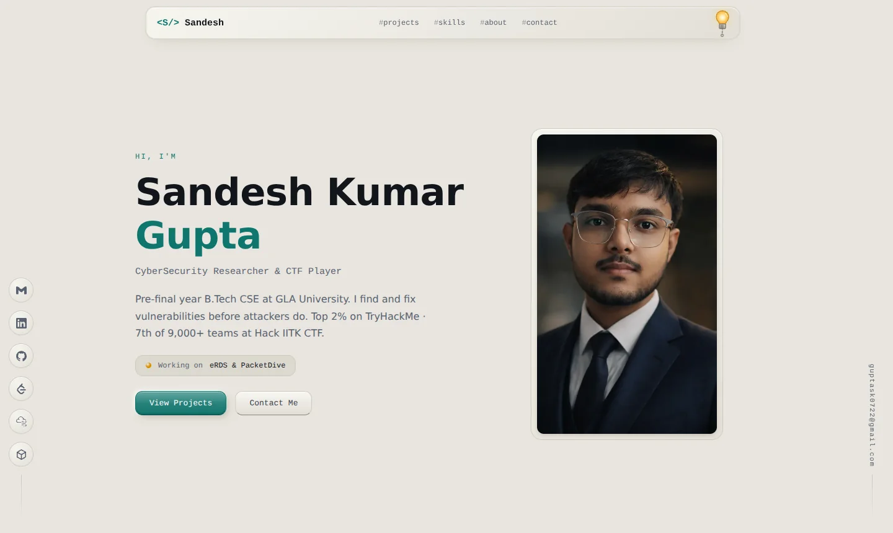
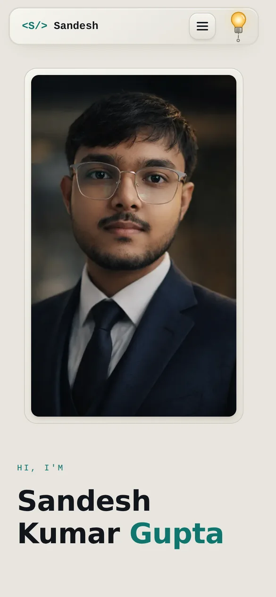
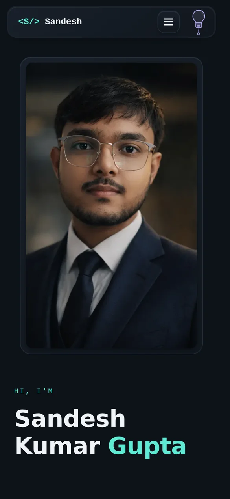
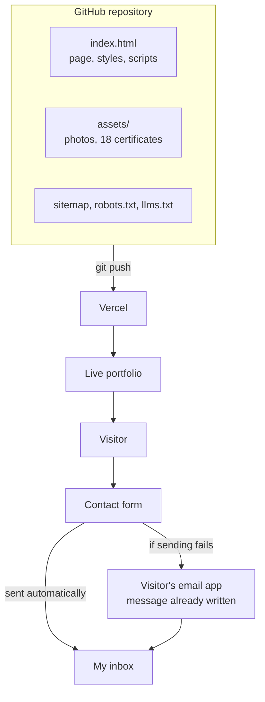

<div align="center">



# Hi, I'm Sandesh

**Cybersecurity student and CTF player. I break things on purpose, with permission, and then build tools so nobody else can do it without permission.**

[Live portfolio](https://sandesh-gupta-portfolio.vercel.app) &nbsp;|&nbsp; [About me](#about-me) &nbsp;|&nbsp; [The portfolio](#the-portfolio) &nbsp;|&nbsp; [How it is put together](#how-it-is-put-together) &nbsp;|&nbsp; [Connect with me](#connect-with-me)

</div>

<br>

## About me

I'm **Sandesh Kumar Gupta** (Sandesh Gupta works too, I answer to both), a pre-final year B.Tech Computer Science and Engineering student at GLA University, Mathura. My specialization is Cybersecurity, Ethical Hacking and AI, which is a fancy way of saying I get graded for the things other people get warned about.

| At a glance | |
| --- | --- |
| **Studying** | B.Tech CSE (2024-2028), specializing in Cybersecurity, Ethical Hacking and AI |
| **Right now** | Cyber Security Intern at the Amroha Police Cyber Security Internship Program (APCSIP-2026) |
| **Focus** | eBPF and Linux kernel security, penetration testing, machine learning for threat detection |
| **Best results** | 7th of 9,000+ teams at Hack IITK CTF 2026, 5th at Scythe CTF (IIT Roorkee) 2026, top 2% on TryHackMe |

### What I am up to right now

My internship keeps me busy with the less glamorous (and more useful) side of security: malware analysis, digital forensics, incident response exercises and vulnerability assessments. The part I like most is the write-up at the end, where a messy investigation has to turn into something another human can follow and fix.

Outside of that, I play CTFs, hunt bugs in bug bounty programs, and work on my own projects.

### What I work on and what I find interesting

| Area | What it means for me |
| --- | --- |
| **Kernel security (eBPF)** | Watching what a system does from inside the kernel. My ransomware defense project, [eRDS](https://github.com/skgpt254/Cyber_Mini-Project), lives here. |
| **Network detection with ML** | Spotting weird traffic without needing a labelled attack dataset. That is [PacketDive](https://github.com/skgpt254/PacketDive). |
| **Web and bug bounty** | Finding the bug before someone with worse intentions does. |
| **Digital forensics** | Working out what happened after the fact, like a detective with fewer dramatic monologues. |
| **LLM and AI security** | Agents and language models are new attack surface, and that is exactly why they are fun. I earned the Certified LLM Security Professional certificate and took part in MumbaiHacks 2025, an agentic AI hackathon. |

I enjoy building a tool all the way through, from the low-level hook to the thing a person actually reads. I also like backend problems, which is how I ended up writing a [URL shortener](https://github.com/skgpt254/Url-Shortner) with caching, queues and rate limiting instead of simply using one.

### What I work with

| Type | What I use |
| --- | --- |
| **Languages** | Python, Go, C and C++, Java, TypeScript, JavaScript |
| **Systems** | Linux (Kali and Ubuntu), eBPF, Docker, Git |
| **Security tools** | Burp Suite, Nmap, Wireshark, Metasploit, OWASP ZAP |
| **Machine learning** | Scikit-Learn (Isolation Forest is a personal favourite) |

### What excites me

A CTF flag finally dropping after an hour of staring at the same screen. A kernel probe catching something in real time. A clean report where the fix is so obvious that everyone wonders why it took a week to find. Also, learning that something I was sure was secure is, in fact, not. Humbling, but educational.

<br>

## The portfolio

### What it is

This repository is the source code of my personal portfolio website: [sandesh-gupta-portfolio.vercel.app](https://sandesh-gupta-portfolio.vercel.app). It is one page that shows my projects, skills, certificates and ways to reach me.

### Why I built it

A resume is a flat PDF, and a PDF cannot swing a pull cord. I wanted one link I could send to anyone, which also works for search engines and AI assistants. My first version used Angular, which hides content behind JavaScript that many crawlers never run. So I rebuilt it as plain HTML, CSS and JavaScript, and everything is now in the page itself.

<picture>
  <source media="(prefers-color-scheme: dark)" srcset="docs/images/desktop-dark.webp">
  
</picture>

<details>
<summary><b>On a phone, in both themes</b></summary>
<br>
<p align="center">
  
  &nbsp;&nbsp;&nbsp;
  
</p>
</details>

### What is inside

It is **one page with five sections**, plus a custom 404 page for wrong addresses.

| Section | What it represents |
| --- | --- |
| **Home** | Who I am in one screen, my headline results, and buttons to the rest |
| **Projects** | Four projects: eRDS, PacketDive, Shortlink Platform (URL shortener) and this portfolio |
| **Skills** | The areas I work in and the tools I use |
| **About** | My story, my internship, my education, a link to my resume and 18 certificates |
| **Contact** | A form that sends a message straight to my inbox |

### Things worth knowing

- **Light bulb theme switch.** The site opens in Light Mode with the bulb on. Click the bulb (or its pull cord) and it switches to Dark Mode and the bulb goes off. The cord sways on its own. Yes, it is a bit much. No, I will not remove it.
- **Certificate viewer.** Click a certificate to see the whole thing, then zoom, drag, swipe or use the keyboard. Casual saving is discouraged, but screenshots are screenshots.
- **Contact form that does not lose messages.** It sends the message automatically, and if that fails it opens the visitor's own email app with everything already written.
- **Progress on the navbar.** The border of the top bar fills in as you scroll.
- **Built to be found.** Structured data, a sitemap and an `llms.txt` help search engines and AI assistants describe me correctly.
- **Responsive and accessible.** Works on phones, with keyboard navigation, a skip link and reduced-motion support.
- **Tested in a real browser.** In dark mode, the navigation links once vanished. We do not talk about it. It is fixed.

<br>

## How it is put together

No framework, no build step, no database. Pushing to GitHub is the whole deployment.



<details>
<summary><b>Project structure</b></summary>

```text
.
|-- index.html            The whole site: HTML, CSS and JavaScript
|-- 404.html              Page for addresses that do not exist
|-- assets/images/        Photos, the social preview image, 18 certificates
|-- docs/
|   |-- MAINTENANCE.md    How to change, deploy and troubleshoot things
|   |-- SEO-GUIDE.md      Search Console, Bing and other tools, step by step
|   `-- images/           Screenshots and badges used in this README
|-- sitemap.xml           For search engines
|-- robots.txt            Crawler rules
|-- llms.txt              A plain-text summary for AI assistants
|-- site.webmanifest      Name and icons for browsers
|-- vercel.json           Hosting settings
|-- favicon.svg, apple-touch-icon.png
|-- google4df08e21eeb8b18c.html   Google Search Console verification file
|-- CONTRIBUTING.md, LICENSE, .gitignore
```

</details>

### Run it locally

```bash
python3 -m http.server 8000
```

Then open http://localhost:8000. That is the entire setup. Nothing to install, which is a nice change.

<br>

## Connect with me

<p align="center">
  <a href="https://www.linkedin.com/in/sandeshkgupta/"></a>
  <a href="https://github.com/skgpt254"></a>
  <a href="mailto:guptask0722@gmail.com"></a>
  <br>
  <a href="https://tryhackme.com/p/sandeshkgupta"></a>
  <a href="https://profile.hackthebox.com/profile/019c9f97-bb38-734d-a5d5-c916377725f8"></a>
  <a href="https://leetcode.com/u/sandeshkgpt/"></a>
  <a href="https://codeforces.com/profile/sandeshkgupta"></a>
</p>

| Where | Good for |
| --- | --- |
| **Email** ([guptask0722@gmail.com](mailto:guptask0722@gmail.com)) | The most direct way to reach me, for anything |
| **LinkedIn** | Internships, opportunities and professional chats |
| **GitHub** | My code, plus issues if you spot a bug in this site |
| **TryHackMe, Hack The Box, LeetCode, Codeforces** | What I am practising these days |
| **[Contact form](https://sandesh-gupta-portfolio.vercel.app/#contact)** | Same as email, with fewer steps |

I'm open to internships, collaborations and security assessments. Please do not ask me to hack anything you do not own. Everything else, say hi.

<br>

---

<div align="center">

The code is [MIT licensed](LICENSE). My photos, certificates and text are mine, so please do not reuse them.<br>
More details: [Maintenance notes](docs/MAINTENANCE.md) | [Search visibility guide](docs/SEO-GUIDE.md) | [Contributing](CONTRIBUTING.md)

</div>

> [!NOTE]
> Please keep `google4df08e21eeb8b18c.html` in the project root. Google Search Console uses it to confirm I own the site, and it has to stay public on the live site.
